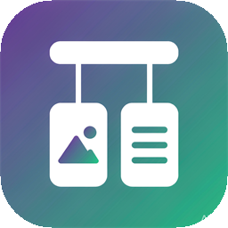
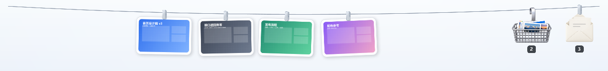
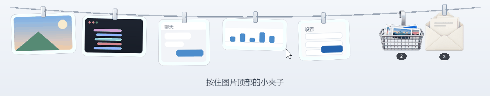
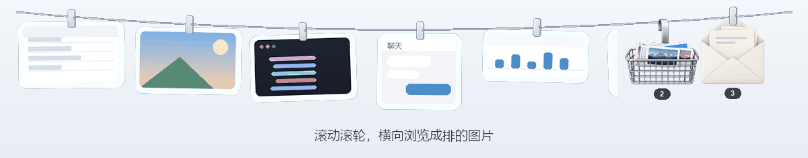
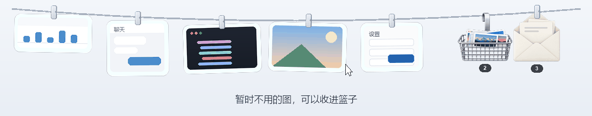
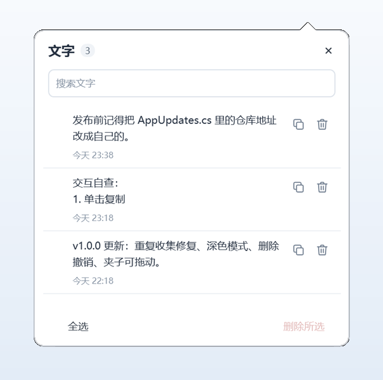
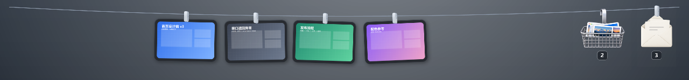

<p align="center">
  
</p>

<h1 align="center">拾帧 · PickSnap</h1>

<p align="center">スクリーンショットとコピーした文字を、画面の上端に張った一本のロープに吊るしておきます。<br>使うときに引き下ろして、取る・位置を変える・そのままデスクトップに置く、好きなように。</p>

<p align="center">
  <a href="https://github.com/lurrrrrr/PickSnap/releases/latest"><strong>最新版をダウンロード</strong></a>
  ·
  <a href="README.md">简体中文</a> ·
  <a href="README.en.md">English</a> ·
  <a href="README.zh-TW.md">繁體中文</a> ·
  <a href="README.ja.md">日本語</a>
</p>

<p align="center">
  <a href="https://github.com/lurrrrrr/PickSnap/releases/latest"></a>
  
  <a href="LICENSE"></a>
</p>



---

## 小さなクリップひとつ、三つの使い方

ロープ上のスクリーンショットには、それぞれ頭の上にアルミの洗濯ばさみが付いています。飾りではありません。コピー、デスクトップにピン留め、位置を変える——すべてこのクリップが取っ手になります。



| 操作 | 結果 |
| --- | --- |
| 画像本体をクリック | クリップボードにコピー |
| 画像を他のウィンドウへドラッグ | 画像ファイルとしてドロップ。元画像はロープに残る |
| 画像の上のクリップをクリック | ロープから外れてデスクトップに落ち、拡大・移動できるピン留めウィンドウになる |
| **クリップを押さえて左右にドラッグ** | **ロープ上の位置を自由に調整** |

新しい並び順は記憶され、次回起動時もそのままです。

枚数が増えても大丈夫。ホイールでロープを横にスクロールでき、端までドラッグすると連続スクロールします。止まると自動で位置が揃うため、画像が画面の端で半分だけ見える状態になりません。



---

## 機能

**収集**

- Windows のスクリーンショットフォルダを監視し、新しい画像を自動で吊るす
- クリップボードの画像と文字も収集できる（画像・文字それぞれにスイッチあり）
- 「画像を追加」で、すでにパソコンにある画像も吊るせる

**ロープに吊るす**

- クリックでクリップボードにコピー。他のウィンドウへドラッグすれば画像ファイルとしてドロップ
- 長押しで注釈モード：枠、矢印、手描き、文字、トリミング、回転。すべて端末内で処理
- ホイールで横スクロール、両端の矢印でもページ送り。端までドラッグすると連続スクロール
- 枚数は画面幅から算出（最少 24 枚）。いっぱいになると最も古い一枚が自動でバスケットへ戻る
- 右クリックメニュー：開く、編集、コピーを保存、保存場所を開く、外してバスケットへ

**デスクトップにピン留め**

画像の上のクリップをクリック（押してすぐ離す）すると、画像はロープから外れて最前面表示のウィンドウとして落ち、拡大・移動できます。ピン留めした画像の上部中央にマウスを移すと画鋲ボタンが現れ、クリックすると元の位置に掛け直されます。

**画像バスケット**

今は使わない画像はここに。クリック選択とドラッグ矩形選択に対応し、選んだ画像をまとめてロープに掛け直せます。ロープ上の画像は、右端のバスケットアイコンへドラッグするか、バスケットウィンドウが開いていればその中へドラッグするだけで外せます。



バスケット上部の「7 日より古い画像を自動整理」は既定でオフ。オンにすると 7 日を超えたスクリーンショットがごみ箱に移ります（詳細は下記のよくある質問）。

**テキスト封筒**

コピーした文字を自動で収集し、全文検索とワンクリックコピーに対応。改行やインデントも保たれます。削除後 5 秒間は「元に戻す」で元の位置に戻せます。保持するのは最新 100 件のみです。

<p align="center"></p>

**範囲キャプチャ**

`Ctrl+Alt+S` で画面を範囲選択し、その場で矩形・円・矢印・ペン・文字・モザイクを描けます。`Enter` で確定、`Esc` で取り消し。

**外観**

ロープは 5 種類（クラシックシルバー、リネンと木製クリップ、白磁、パステル、グラファイト）。配色はシステムに追従させることも、ライト／ダークに固定することもできます。複数モニターでは特定の画面に固定、またはマウスのある画面に追従させられます。

<details>
<summary>ダークモード</summary>



</details>

---

## インストール

### 1. インストーラーをダウンロード（推奨）

1. [Releases](https://github.com/lurrrrrr/PickSnap/releases/latest) を開き、`PickSnap-<バージョン>-windows-x64.zip` をダウンロード
2. 任意の場所に展開し、`Install.cmd` をダブルクリック
3. ファイルは `%LOCALAPPDATA%\Programs\PickSnap` に配置され、デスクトップショートカットが作られてそのまま起動します

管理者権限もシステムサービスも不要です。アンインストールは Windows の「設定 → アプリ」から。アンインストールすると収集した画像と設定も一緒に削除されます。

`Install.cmd` を使わずに直接実行することもできます。`app\PickSnap.exe` をダブルクリックしてください。初回起動時にデスクトップショートカットが作成され、その後はトレイの「その他の操作 → デスクトップショートカットを作成」でいつでも再作成できます。

**動作環境**：Windows 10 / 11 64 ビット、.NET Framework 4.8（Windows 10 1809 以降は標準搭載）。内蔵エディターは [WebView2 Runtime](https://developer.microsoft.com/microsoft-edge/webview2/) を必要とします（Windows 11 には標準搭載。一部の Windows 10 では別途インストールが必要ですが、未インストールでも範囲キャプチャ内の注釈は使えます）。

### 2. ソースからビルド

```powershell
git clone https://github.com/lurrrrrr/PickSnap.git
cd PickSnap
./scripts/build.ps1
```

生成物は `build\` に置かれます。`build\PickSnap.exe` を実行してください。配布用 zip は `./scripts/build.ps1 -Package` で作れます。

---

## 使い始めの 3 ステップ

1. **撮る**：`Win+Shift+S`、`PrtScn`、または WeChat の `Alt+A`。別途保存する必要はありません
2. **引き下ろす**：マウスを画面の最上部に移すと、ロープが画像を連れて降りてきます
3. **取る**：クリックでコピー、またはチャット・ドキュメント・フォルダへそのままドラッグ

<details>
<summary>ショートカットと操作一覧</summary>

| 操作 | 方法 |
| --- | --- |
| ロープの表示 / 収納 | `Ctrl+Alt+T`、またはトレイアイコンをクリック |
| 範囲キャプチャ | `Ctrl+Alt+S`、またはトレイパネル上部の「範囲キャプチャ」 |
| キャプチャショートカットの変更 | トレイ →「その他の操作」→「キャプチャショートカット」 |
| 画像をコピー | 画像をクリック |
| 元画像を開く | 画像をダブルクリック |
| ロープ上の位置を調整 | 画像の上のクリップを押さえて左右にドラッグ |
| デスクトップにピン留め / 掛け直す | クリップをクリック / ピン留め画像の画鋲をクリック |
| 注釈 | 画像を長押し、または右クリック →「編集」 |
| 外してバスケットへ | 右クリック →「外してバスケットへ」、またはバスケットアイコンへドラッグ |
| 画像バスケットを開く | ロープ右端のバスケットをクリック |
| テキスト封筒を開く | ロープ右端の封筒をクリック |
| 画面を選択 | トレイを右クリック →「表示する画面」 |
| 外観、起動時に実行、更新を確認 | トレイを右クリック |

</details>

---

## データとプライバシー

すべて端末内に保存されます。画像はプログラムフォルダー配下の `data\Captures`、設定と文字は `data\state.json` に。一切アップロードしません。ネットワーク通信は「更新を確認」を手動で実行したときに GitHub Releases のバージョン情報を読むだけです。

画像が自動的に消えることはありません。ロープに置ける枚数には限りがあり、入りきらない分はバスケットに戻りますが、ファイルは端末に残り、整理するかどうかはユーザーが決めます（任意の「古い画像の自動整理」も、期限を過ぎたコピーをごみ箱に移すだけです）。テキスト封筒は最新 100 件のみを保持し、古いものは新しい内容に押し出されます。

---

## よくある質問

<details>
<summary>スクリーンショットが自動で出てきません</summary>

既定では Windows のスクリーンショットフォルダだけを監視しています。`Win+Shift+S`、`PrtScn`、WeChat のキャプチャのようにクリップボードに画像を置く方式では、先にトレイパネル →「クリップボード収集」で「画像を収集」をオンにしてください。

「新しい画像を自動で吊るす」をオフにしている場合、新しい画像は画像バスケットに入ります。選んで「ロープに掛ける」をクリックしてください。

</details>

<details>
<summary>「外す」と「削除」はどう違いますか？</summary>

「外してバスケットへ」はロープから外すだけで、ファイルも記録も残り、いつでも掛け直せます。削除は収集したコピーをごみ箱に移します。スクリーンショットフォルダ内の元画像については、PickSnap の記録から外すだけでファイル自体は変更しません。

</details>

<details>
<summary>端までドラッグするとスクロールが止まりません</summary>

カーソルをロープの左右の端に寄せると連続で横スクロールします。目的の画像が見えたら離せばすぐに止まり、画像の端に合わせて位置が整います。

</details>

<details>
<summary>画像は自動で整理されますか？</summary>

既定では画像を自動的に**削除することはありません**。

任せたい場合は、画像バスケットを開き、タイトルバー右側の「7 日より古い画像を自動整理」（既定オフ）をオンにしてください。オンにした時点で一度チェックし、以降は起動時と 6 時間ごとに確認して、7 日を超えた画像をごみ箱に移します。ごみ箱に入るので後で復元できます。手動で追加した、収集フォルダ外の元画像は記録から外すだけでファイルは消しません。新旧はファイルの現在の更新日時で判定するため、注釈を付けた画像が誤って整理されることはありません。同じスイッチでいつでもオフに戻せます。

</details>

<details>
<summary>対応している画像形式は？</summary>

PNG、JPG、BMP、GIF、TIF です。GIF と TIF は編集に最初の 1 フレームのみを使用し、トリミング・回転・モザイクは画像全体に適用されます。

</details>

<details>
<summary>容量はどれくらい？いっぱいになると？</summary>

ロープの枚数は画面幅から算出され、最少 24 枚。入りきらない画像はバスケットで待機し、破棄されることはありません。

テキスト封筒は最新 100 件のみを保持し、古いものは自動的に押し出されます。クリップボードの文字は使い捨ての内容なので、順に流れていくだけです。

画像バスケットが **100 枚**を超えると、新しい画像を受け取るたびに一度だけ通知します。PickSnap が画像を勝手に**削除することはありません**。何をいつ消すかはユーザーが決めます。バスケットで複数選択して削除してください。削除したコピーはごみ箱に入ります。

</details>

<details>
<summary>更新方法は？</summary>

トレイを右クリック →「その他の操作」→「更新を確認」。ダウンロード完了後に再起動してください。画像・設定・スタートアップ登録はそのまま引き継がれます。

</details>

---

## 開発

C# + WPF（.NET Framework 4.8）。MSBuild には依存せず `csc` で直接コンパイルします。

```powershell
./scripts/build.ps1          # ビルド
./scripts/build.ps1 -Package # ビルドして配布用 zip を作成
```

ソースは `src\`、サードパーティ製コンポーネントは `vendor\`、ビルドとパッケージのスクリプトは `scripts\` にあります。

---

## クレジットとライセンス

本プロジェクトは以下のオープンソースプロジェクトを改変したものです。原作者に感謝します。

- [Tendedero](https://github.com/alejandrobujan/tendedero)：macOS 版のオリジナル、作者 [Alejandro Buján](https://github.com/alejandrobujan)
- [PicRope](https://github.com/Renly1994/PicRope)：Windows への移植版、作者 [Renly1994](https://github.com/Renly1994)

オリジナルの著作権は Alejandro Buján に帰属し、MIT ライセンスで公開されています。本リポジトリの改変部分も同様に MIT です。上流ライセンスの「名称とアイコン」条項に従い、本プロジェクトは独自名称「拾帧 / PickSnap」と独自アイコンを使用しています。由来の詳細とサードパーティの宣言は [NOTICE](NOTICE)、ライセンス条項は [LICENSE](LICENSE) を参照してください。
