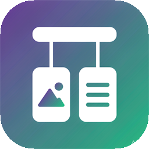
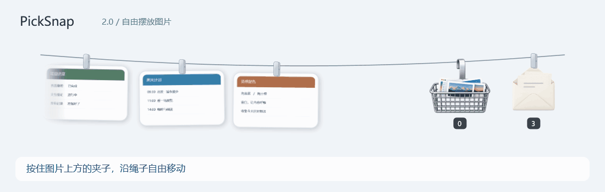
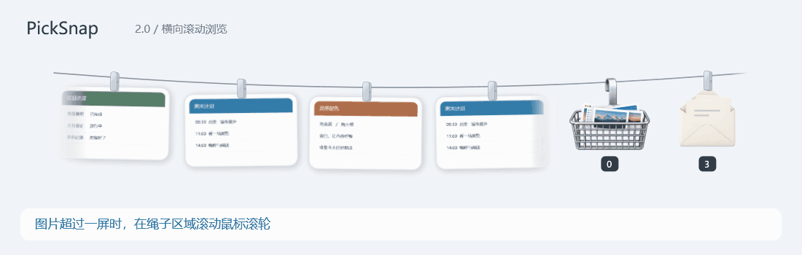
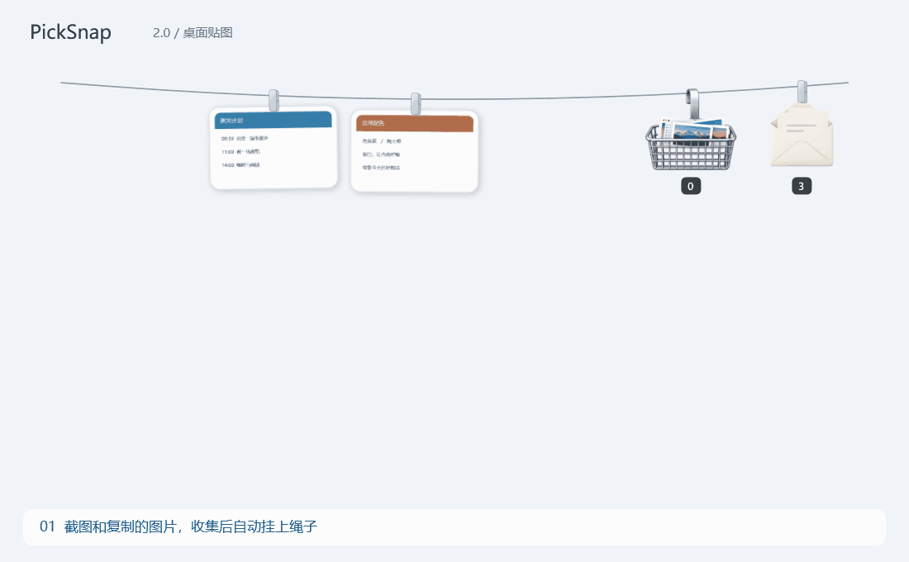
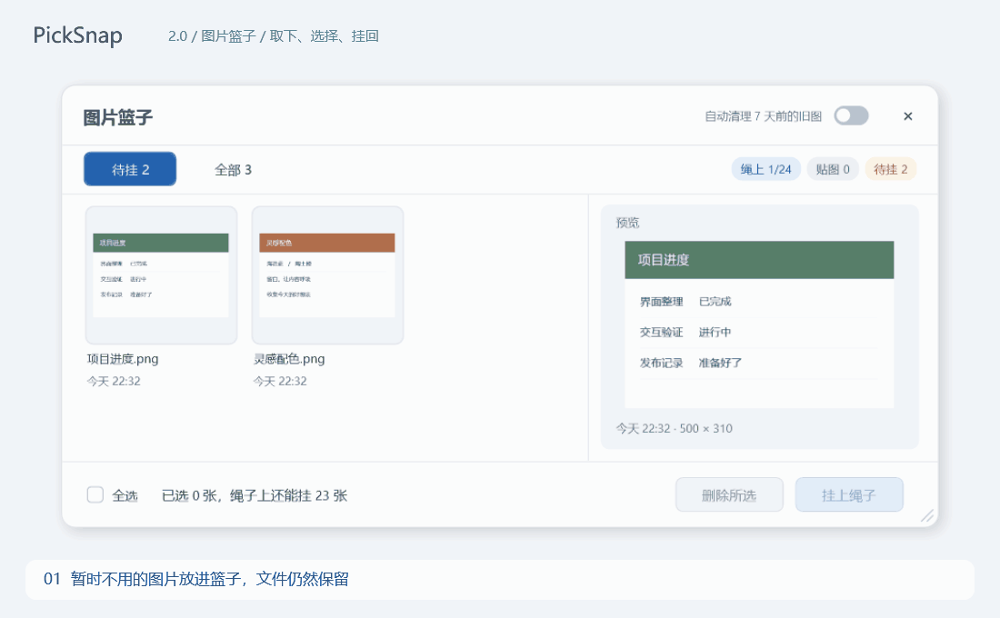
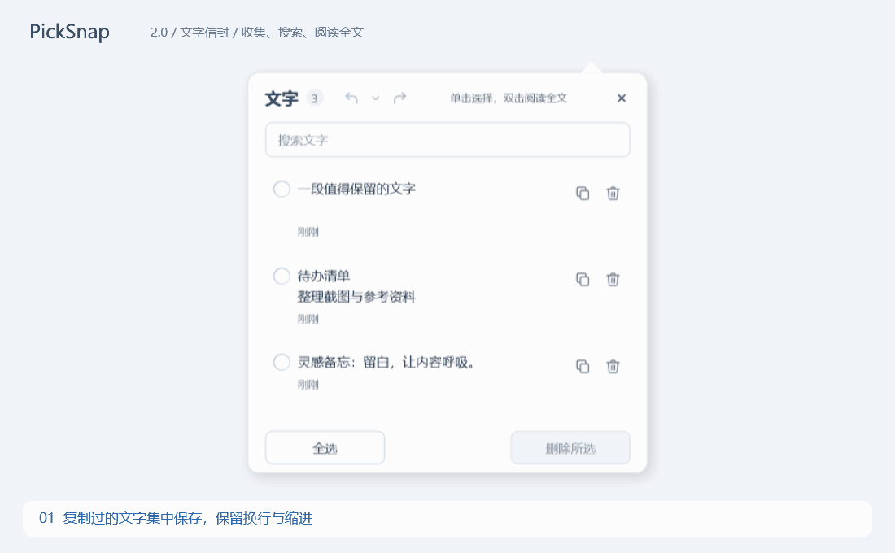

<p align="center"></p>
<h1 align="center">PickSnap</h1>
<p align="center"><strong>把截图挂在屏幕顶边，把零散的文字收进信封。</strong><br>一个轻量的 Windows 剪贴展示工具，用来随手复制、拖放和对照。</p>
<p align="center">
  <a href="https://github.com/lurrrrrr/PickSnap/releases/latest">下载最新版</a> ·
  <a href="#快速开始">快速开始</a>
</p>
<p align="center">简体中文 · <a href="docs/i18n/README.en.md">English</a> · <a href="docs/i18n/README.zh-Hant.md">繁體中文</a> · <a href="docs/i18n/README.ja.md">日本語</a></p>
<p align="center">
  
  
  <a href="LICENSE"></a>
</p>

## 核心功能

### 自由摆放图片

**按住小夹子沿绳子拖动，图片就停在你放下的位置。** 可以留出间距、将参考图放在一起，其他图片保持原位。位置会被记住，下次打开仍然保留。



### 横向滚动浏览

**在绳子区域滚动鼠标滚轮，即可横向浏览超出一屏的图片。** 卡片之间的空白区域也能响应滚轮，少量图片也可移动到可视区边缘。停下后自动对齐；拖动夹子到左右两端，都能继续扩展，把图片移到更远的位置。



### 自动收集与桌面贴图

截图或复制图片后，图片自动挂到屏幕顶边。需要对照时单击小夹子，把它钉在桌面；用完点一下图钉，挂回原处。贴图可以拖动、滚轮缩放。



单击图片复制，双击打开原图；按住图片可以拖到聊天框、文档或文件夹，按住小夹子则调整绳上位置。图片多时，用滚轮横向浏览。

### 图片篮子

「放进篮子」只把图片从绳上取下，不删除文件。篮子支持待挂／全部、预览、多选和批量挂回，实时显示已选数量与绳上剩余位置。



### 文字信封

开启「收集文字」后，复制过的文字自动保存，保留换行和缩进。单击整行选中，双击被截断的长文正文阅读全文；可搜索、复制、多选删除，并撤销或重做删除。




## 更多功能

| 功能 | 用法 |
| --- | --- |
| 区域截图与标注 | 默认 `Ctrl+Alt+S`，支持矩形、圆形、箭头、画笔、文字与马赛克；Enter 完成，Esc 取消 |
| 图片编辑 | 长按图片，或右键「编辑」；支持裁剪、旋转和标注；点击「完成」保存并自动复制，在本机处理 |
| 显示／收起绳子 | 默认 `Ctrl+Alt+T`；也可把鼠标移到顶边，停留后展开 |
| 自定义快捷键 | 修改后立即生效；组合冲突会提示，并保留原来的有效绑定 |
| 两个收集开关 | 图片和文字独立开关；图片开关同时控制系统截图与复制的图片 |
| 外观与多屏 | 五套绳子主题；浅色、深色或跟随系统；固定屏幕或跟随鼠标 |
| 轻量托盘 | 显示绳子、篮子、信封、添加图片、截图、收集开关、设置与退出 |

首次使用默认在整个顶边停留 **450 毫秒**后展开，右上角窗口按钮区域会避让。触发范围与等待时间可在设置中调整。区域截图支持在任一已连接屏幕框选，每次选区位于一块屏幕内。

选择「跟随系统」时会显示当前使用的浅色／深色。切换配色选项但实际颜色不变时，无需重启；实际深浅色变化仍需重启应用。目前系统配色在启动时读取。

## 快速开始

1. 从 [Releases](https://github.com/lurrrrrr/PickSnap/releases/latest) 下载 `PickSnap-2.1.1-windows-x64.zip`，**先完整解压**。
2. 双击 `Install.cmd`。程序安装到 `%LOCALAPPDATA%\Programs\PickSnap`，创建桌面快捷方式并启动，不需要管理员权限。
3. 截一张图，再把鼠标移到屏幕顶边；单击图片即可复制使用。

同一个压缩包也支持直接运行 `app\PickSnap.exe`。使用 `Install.cmd` 安装后，下载并解压的临时文件夹可以删除。

**运行环境：** Windows 10 / 11 x64、.NET Framework 4.8。内置图片编辑器需要 [Microsoft Edge WebView2 Runtime](https://developer.microsoft.com/microsoft-edge/webview2/)；缺少运行库时请先安装。区域截图自带的标注功能不依赖 WebView2。

## 收集、保留和清理，有什么区别？

- **自动收集**：开启图片收集后，系统截图文件夹中的新图与剪贴板图片自动上绳。文字收集需要单独开启。关闭开关不会删除已有内容；也可随时从托盘「添加图片」。
- **放进篮子**：保留图片，只取消绳上展示。自动收图遇到绳子满时，较早的图片会退回篮子；手动从篮子挂回只使用空位。
- **移到回收站**：把 PickSnap 保存的图片文件送入 Windows 回收站，同时移除记录。新收集／添加的图片保存为本地副本；旧版本直接引用的外部文件仅移除记录。
- **七天旧图清理**：首次使用默认开启，超过七天的收集副本会移入回收站，包括仍在绳上展示的旧图。要长期保留，请关闭自动清理，或用「保存副本」另存到其他目录。升级保留已有设置。
- **文字保留**：最多保存最近 100 条。删除历史保留到本次文字面板关闭，最多 20 批；支持逐条／整批撤销和 Ctrl+Z、Ctrl+Y。关闭面板后不再提供本次撤销历史。

### Windows 截图工具中的编辑会自动同步吗？

开启「收集图片」后，在 Windows 截图工具中编辑并点击「复制」，PickSnap 会尝试用编辑结果更新原卡片，保留摆放位置和贴图状态。部分截图工具会自动将编辑结果写入剪贴板，因此**未点击「复制」也可能更新**；如果没有写入剪贴板，仅仅等待不会更新。

更新的是 **PickSnap 保存的图片副本，不会修改 Windows 截图文件夹里的原文件**。正常情况下约 1 秒后更新，连续修改会稍作等待；剪贴板被占用或远程同步时可能更久。

PickSnap 根据近期截图、来源和画面相似度判断是否属于同一张图片。关联有效期约为 10 分钟，成功更新后可继续关联后续编辑；超过有效期或改动过大、无法确认关联时，有效的新图片会作为新图收集。损坏或无法读取的图片不会直接替换原卡片。

以上是 Windows 截图工具的同步方式。使用 **PickSnap 内置图片编辑器**时，点击「完成」会直接保存并自动复制编辑结果。

## 更新与卸载

「设置 → 更新与卸载」会持续显示检查结果。检查更新只查询正式 GitHub Releases；发现新版后，查看说明并点击「更新并重启」，下载、校验完成后自动安装，保留图片、文字和设置。网络失败或限流会明确显示，不会当作“已是最新版”。

卸载入口在同一页面，也可从 Windows 应用列表卸载安装过的程序。默认保留数据到 `%LOCALAPPDATA%\PickSnap\Data`，再次通过 `Install.cmd` 安装时恢复；已有暂存另存为备份。选择删除当前数据需要额外确认，**此操作不可撤销**。直接运行的程序会提示退出后删除所在文件夹，避免误删同目录里的其他文件。

## 数据与隐私

图片、文字和设置保存在本机的程序目录下：

```text
data/
├── Captures/        收集的图片副本
├── state.json       设置与文字记录
└── state.json.bak   上一份配置备份
```

远程控制软件若同步剪贴板，对端 PickSnap 也可能收集同步过来的图片；可关闭对端的「收集图片」。远控期间截图编辑卡顿时，可对比关闭剪贴板同步或退出 PickSnap 后的情况。

PickSnap 不上传收集内容。手动检查及后台定期检查更新会访问 GitHub Releases。自动清理默认开启，重要内容请主动另存；文字信封用于临时收纳，不是无限期备份。

## 来源与许可

PickSnap 在 [Tendedero](https://github.com/alejandrobujan/tendedero) 和 [PicRope](https://github.com/Renly1994/PicRope) 的基础上开发，感谢 Alejandro Buján、Renly1994 及上游贡献者。

使用独立名称与图标，遵循仓库 [LICENSE](LICENSE)；来源与第三方组件声明见 [NOTICE](NOTICE)。
