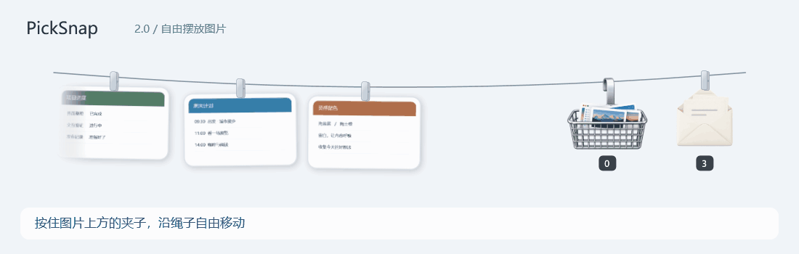
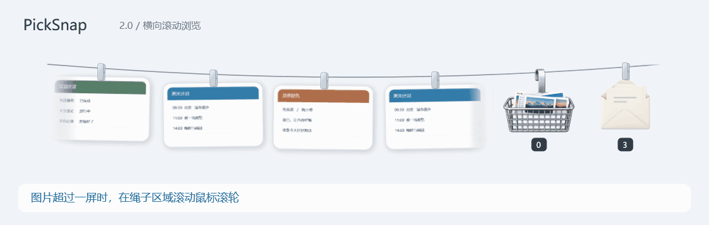
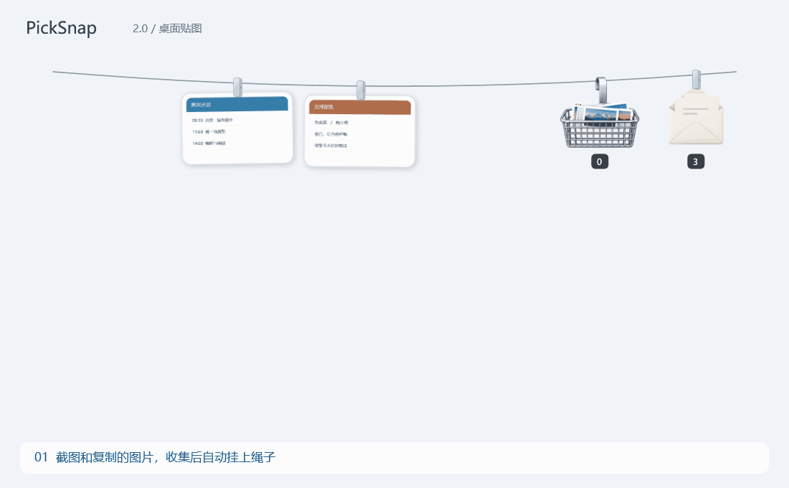
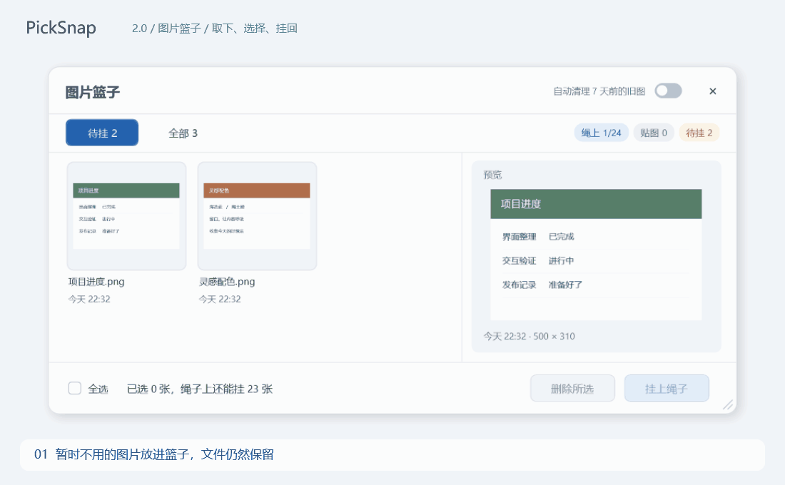
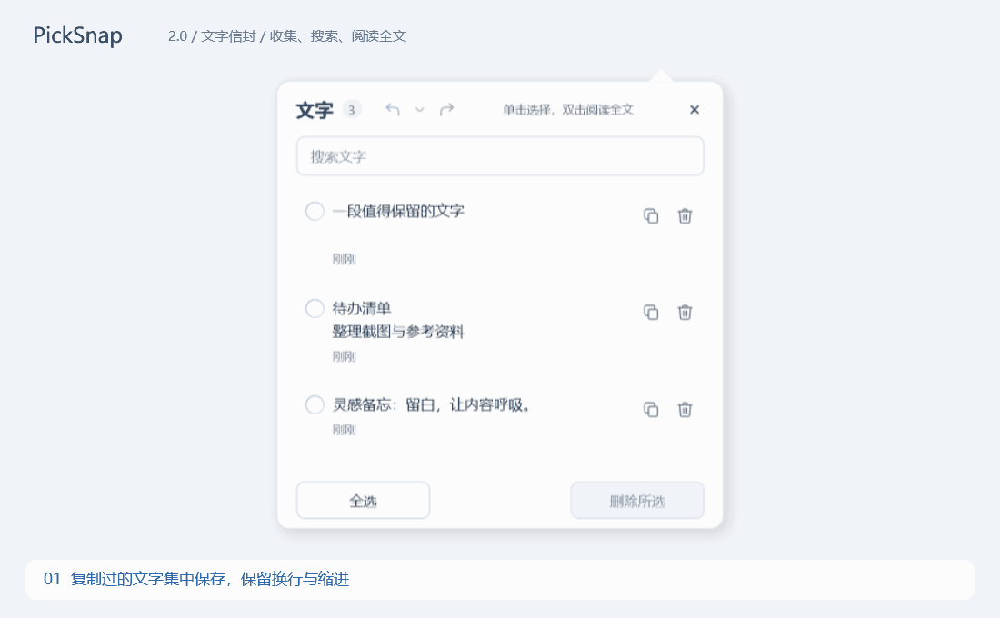

# PickSnap

**Keep screenshots on a clothesline at the top of your Windows desktop. Save copied text in an envelope.**

[Download](https://github.com/lurrrrrr/PickSnap/releases/latest) · [简体中文](../../README.md)

## Free placement and horizontal scrolling

## See it in action

### Collect, pin, return

Screenshots and copied images appear on the rope. Click a clip to turn an image into an always-on-top reference; click its pin to return it. Drag to move a pinned image and use the wheel to zoom.

Click an image to copy it, double-click to open it, or drag it into another app. Drag its clip to rearrange it on the rope; scroll to browse more images.

### A basket for images you will use later

Taking an image off the rope keeps its file. Preview and select pending images, then hang them back together. The counters show rope capacity, pinned images and pending items.

### An envelope for copied text

Enable text collection separately. Search saved text, click a row to select it, or double-click truncated long text to read it in full. Copy and delete buttons work independently. Deletions support undo and redo while the panel remains open.

Demos use sample content and actual application views. Their captions are in Chinese.

## Get started

1. Download and fully extract `PickSnap-2.0.0-windows-x64.zip` from Releases.
2. Run `Install.cmd`. It installs under `%LOCALAPPDATA%\Programs\PickSnap` and creates a desktop shortcut; no administrator access is needed.
3. Take a screenshot, move the pointer to the top edge, and click an image to copy it.

The same package also runs directly via `app\PickSnap.exe`. Requires Windows 10/11 x64 and .NET Framework 4.8. The image editor needs Microsoft Edge WebView2 Runtime; the region-capture annotation tools do not.

| Feature | Default interaction |
| --- | --- |
| Show / hide rope | `Ctrl+Alt+T`, tray icon, or dwell at the top edge |
| Region capture | `Ctrl+Alt+S`; Enter finishes, Esc cancels |
| Edit an image | Hold the image or choose Edit in its context menu |
| Collection | Separate image and text switches in the tray and settings |
| Appearance | Five rope themes; light, dark, or system colors |
| Multiple displays | Fixed display or follow the pointer; capture on any connected display |

Both shortcuts are customizable. On first use, top-edge activation covers the full width with a 450 ms delay, except the top-right window-button area.

## Understand data retention

- **Seven-day image cleanup is enabled on first use.** Old collected copies go to the Windows Recycle Bin, including old images still on the rope. Turn cleanup off or save a separate copy for long-term storage. Existing settings are preserved on upgrade.
- Moving an image into the basket does not delete it. A full rope moves older images into the basket; manual hanging uses only free slots.
- New image imports are local copies. Deleting legacy external-file records does not delete the external original.
- Text collection retains the latest 100 entries. Undo history lasts until the text panel closes, up to 20 deletion batches.
- Content remains local in `data/Captures` and `data/state.json`; `state.json.bak` is the previous configuration backup. Update checks contact GitHub Releases.

Windows Snipping Tool edits can replace a recent related image only after the edited bitmap reaches the clipboard, automatically or via Copy. Matching is heuristic; a roughly three-second delay groups related edits. Large changes or older captures may become new images instead.

## Updates and removal

Open Settings → Updates and uninstall. Checking does not install anything. Confirm “Update and restart” to download, verify and install an update. Network errors and rate limits remain visible.

Uninstall keeps data by default under `%LOCALAPPDATA%\PickSnap\Data`; reinstalling with `Install.cmd` restores it. Deleting current data requires an extra confirmation and is irreversible. For direct execution, the app explains which program folder to delete after exit.

## Credits

Based on [Tendedero](https://github.com/alejandrobujan/tendedero) and [PicRope](https://github.com/Renly1994/PicRope). Thanks to Alejandro Buján, Renly1994 and upstream contributors. See [LICENSE](../../LICENSE) and [NOTICE](../../NOTICE).
