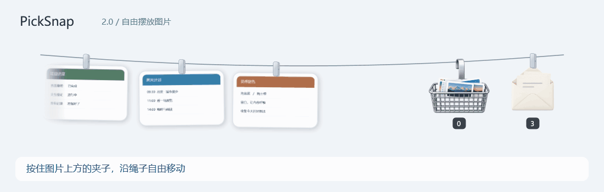
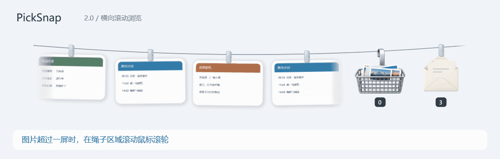
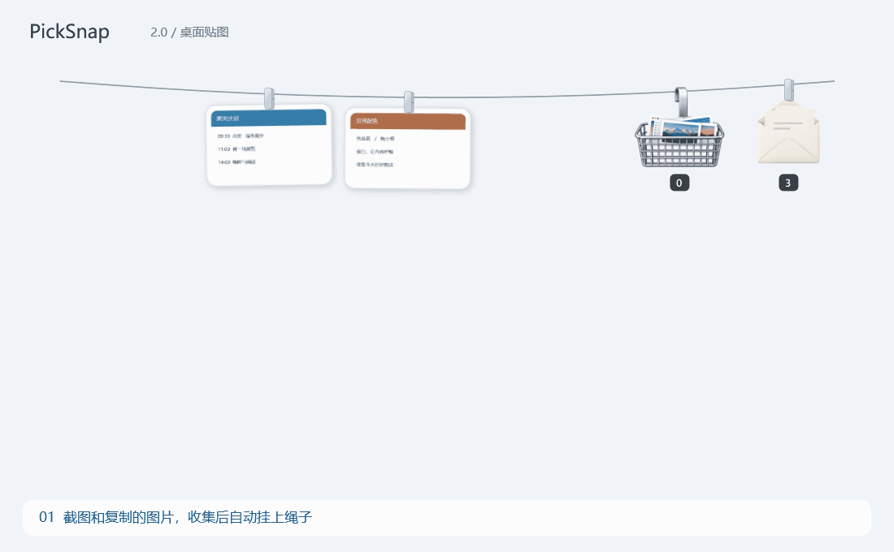
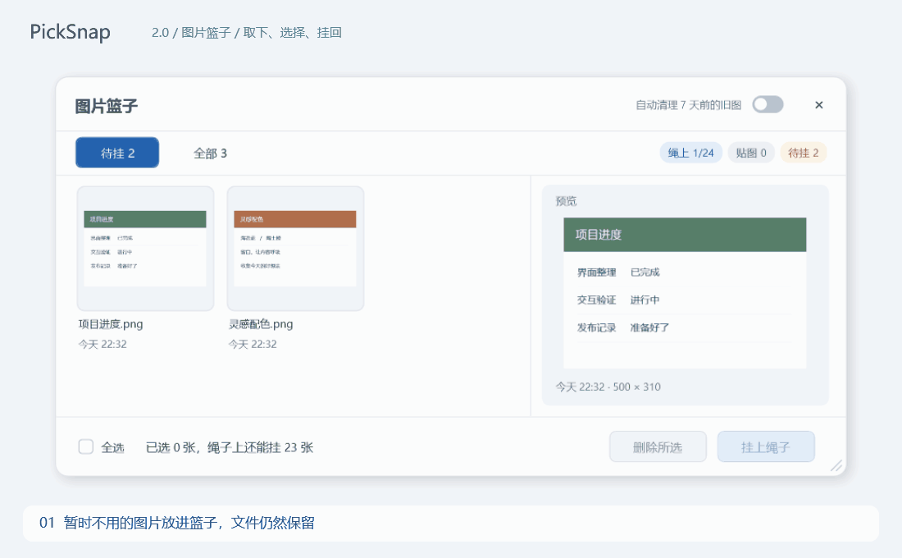
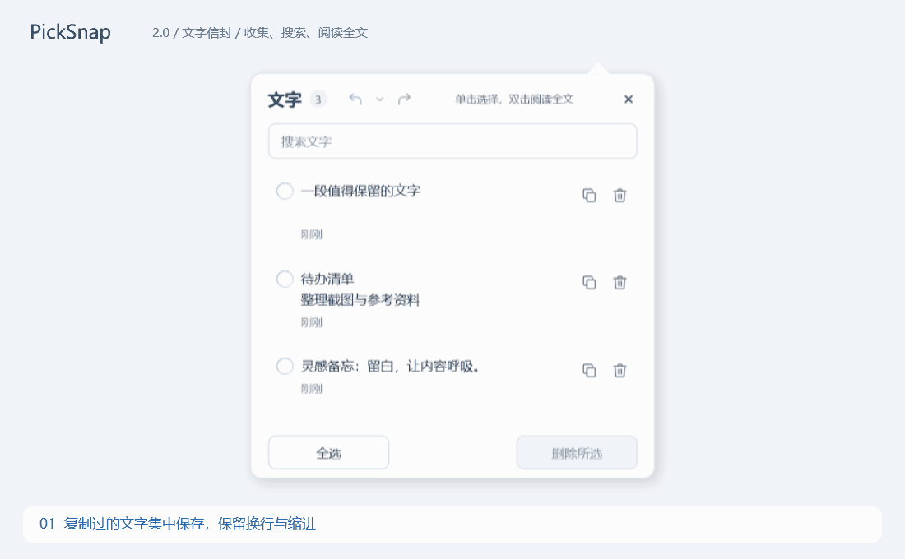

# PickSnap

**スクリーンショットを画面上端のロープに。コピーしたテキストを封筒に。** Windows 用の軽量なクリップ表示ツールです。

[ダウンロード](https://github.com/lurrrrrr/PickSnap/releases/latest) · [简体中文](../../README.md)

## 自由な配置と横スクロール

## 操作を見る

### 画像を集めて、デスクトップにピン留め

スクリーンショットやコピーした画像がロープに並びます。クリップをクリックすると最前面の画像になり、ドラッグで移動、ホイールで拡大・縮小できます。上部のピンをクリックすると元の場所へ戻ります。

画像のクリックでコピー、ダブルクリックで原画像を開きます。画像を別アプリへドラッグすることもできます。クリップのドラッグはロープ上の並べ替えです。

### 一時的に使わない画像はバスケットへ

バスケットへの移動はファイルを削除しません。プレビュー、複数選択、一括でロープへ戻す操作ができ、空き枠数も確認できます。

### テキストは封筒に

テキスト収集を有効にすると、コピーした文章を改行やインデント付きで保存します。行のクリックで選択、省略された長文本文のダブルクリックで全文表示。検索、コピー、削除、元に戻す／やり直しに対応します。

デモはサンプル内容と実際のアプリ画面を使用しています。字幕は簡体字中国語です。

## はじめに

1. Releases から `PickSnap-2.1.2-windows-x64.zip` をダウンロードし、すべて展開します。
2. `Install.cmd` を実行します。管理者権限なしで `%LOCALAPPDATA%\Programs\PickSnap` にインストールされます。
3. スクリーンショットを撮り、ポインターを画面上端に移動してロープを表示します。

同じパッケージの `app\PickSnap.exe` を直接起動することもできます。Windows 10/11 x64 と .NET Framework 4.8 が必要です。画像エディターには Microsoft Edge WebView2 Runtime が必要ですが、範囲キャプチャ内の注釈機能には不要です。

- 表示／非表示は既定で `Ctrl+Alt+T`、範囲キャプチャは `Ctrl+Alt+S`。両方とも変更できます。
- キャプチャは Enter で確定、Esc でキャンセル。矢印、文字、モザイクなどを追加できます。
- 画像の長押し、または右クリックの編集で切り抜き・回転・注釈ができます。
- 5 種類のロープテーマ、ライト／ダーク／システム配色、複数画面に対応。
- システム配色では現在の明暗を表示します。実際の色が変わらない選択変更では再起動しません。明暗が変わる場合は再起動し、システム配色は起動時に読み込みます。
- 初回は上端全体で 450 ミリ秒待つと展開します。右上のウィンドウ操作ボタン付近は除外します。

## 保存と削除

**初回は「7 日前の画像を自動整理」が有効です。** ロープ上の古い画像も含め、収集したコピーをごみ箱へ移します。長期保存する画像は別名保存するか、自動整理を無効にしてください。更新時は既存の設定を保持します。

ロープが満杯になると古い画像がバスケットに戻ります。手動で戻す場合は空き枠だけを使用します。新しい画像はローカルコピーとして保存され、旧版の外部ファイル参照は記録のみ削除します。

テキストは最新 100 件を保存します。削除履歴はパネルを閉じるまで、最大 20 バッチです。画像は `data/Captures`、設定と文章は `data/state.json` に保存されます。収集内容は送信しません。更新チェックは GitHub Releases に接続します。

Windows のスクリーンショット編集は、編集結果がクリップボードに書き込まれた場合のみ関連画像を更新できます。コピー操作または自動書き込みが対象です。時刻や画像の類似度による推定なので、大きな変更や時間が経った画像は新規画像になる場合があります。

## 更新とアンインストール

設定の更新ページに確認結果が表示されます。確認だけではインストールしません。「更新して再起動」を選ぶと、ダウンロード・検証後にインストールします。通信エラーやアクセス制限も表示します。

アンインストールは既定で `%LOCALAPPDATA%\PickSnap\Data` にデータを残し、`Install.cmd` での再インストール時に復元します。現在のデータを削除する場合は追加確認が必要で、元に戻せません。直接起動の場合は終了後に指定のプログラムフォルダーを削除します。

[Tendedero](https://github.com/alejandrobujan/tendedero) と [PicRope](https://github.com/Renly1994/PicRope) を基に開発しました。原作者と貢献者に感謝します。[LICENSE](../../LICENSE) · [NOTICE](../../NOTICE)。
