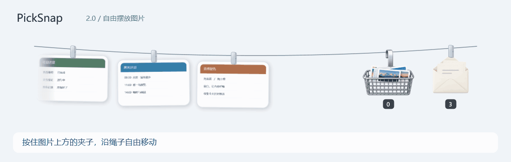
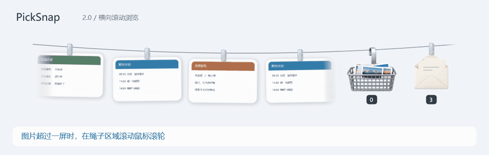
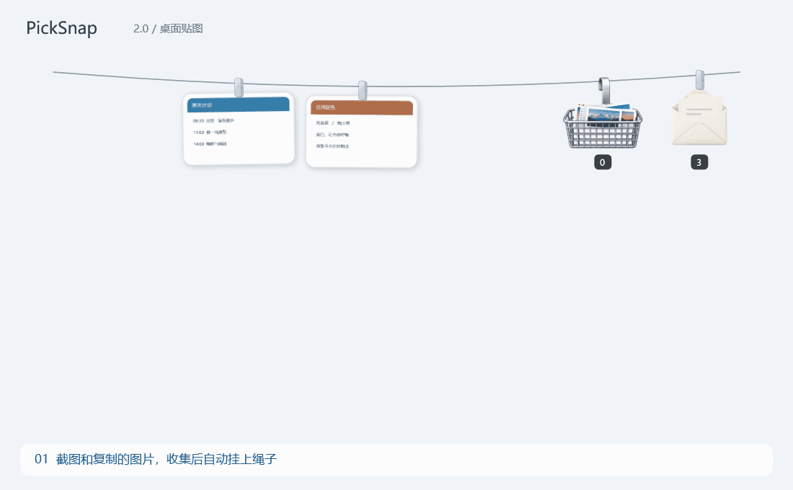
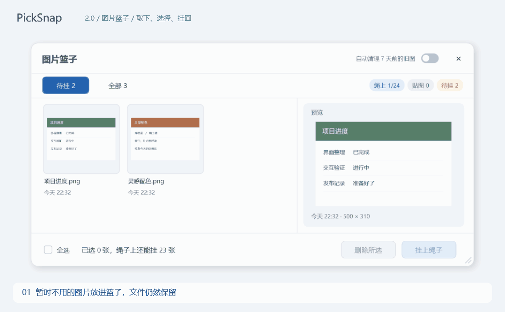
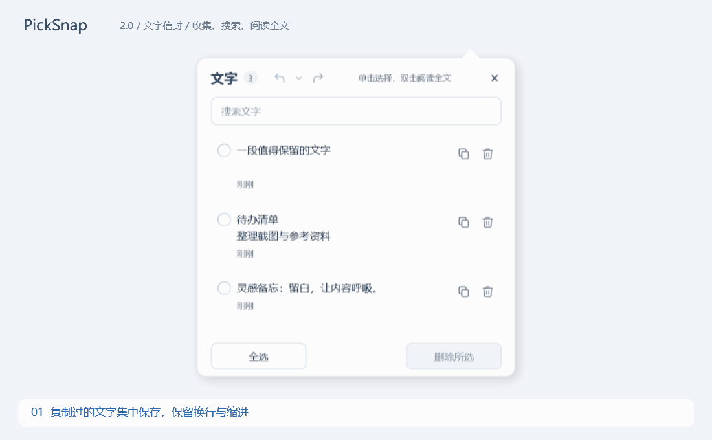

# PickSnap

**把截圖掛在螢幕頂邊，把零散文字收進信封。** 輕量的 Windows 剪貼展示工具，方便複製、拖放和對照。

[下載最新版](https://github.com/lurrrrrr/PickSnap/releases/latest) · [简体中文](../../README.md)

## 自由擺放與橫向瀏覽

## 看看實際操作

### 截圖上繩，隨手變成桌面貼圖

截圖或複製圖片後自動上繩。單擊小夾子變成置頂貼圖，拖曳移動、滾輪縮放；單擊貼圖頂部的圖釘掛回原處。單擊圖片複製、雙擊開啟原圖，按住圖片可拖到其他程式；拖動夾子則調整繩上位置。

### 暫時不用的圖片放進籃子

放進籃子只取消展示，不刪除檔案。支援待掛／全部、預覽、多選和批次掛回，顯示繩上容量、貼圖及待掛數量。

### 複製的文字收進信封

獨立開啟「收集文字」後保存剪貼簿文字，保留換行與縮排。單擊整行選擇，雙擊被截斷的長文正文閱讀全文；可搜尋、複製、多選刪除、復原與重做。

演示使用範例內容與實際介面，字幕為簡體中文。

## 快速開始

1. 下載並完整解壓縮 `PickSnap-2.1.0-windows-x64.zip`。
2. 執行 `Install.cmd`，安裝到 `%LOCALAPPDATA%\Programs\PickSnap`，不需管理員權限。
3. 截圖後將滑鼠移到螢幕頂邊，展開繩子並單擊圖片複製。

同一套件可直接執行 `app\PickSnap.exe`。需要 Windows 10/11 x64、.NET Framework 4.8；圖片編輯器需要 Microsoft Edge WebView2 Runtime，區域截圖內的標註不依賴它。

- 顯示／收起：預設 `Ctrl+Alt+T`；區域截圖：`Ctrl+Alt+S`。兩組快捷鍵皆可自訂。
- 區域截圖：Enter 完成、Esc 取消，支援矩形、箭頭、文字、馬賽克等標註。
- 長按圖片或右鍵「編輯」，可裁切、旋轉與標註。
- 五套繩子主題，支援淺色、深色、跟隨系統及多螢幕。
- 跟隨系統時顯示目前配色；選項切換但實際顏色不變時不重啟。實際深淺色變更仍會重啟，系統配色於啟動時讀取。
- 首次使用預設在整個頂邊停留 450 毫秒展開，右上角視窗按鈕區域會避讓。

## 保留與清理

**首次使用預設開啟七天舊圖清理。** 過期的收集副本會移入 Windows 資源回收筒，包括仍掛在繩上的舊圖。要長期保留，請關閉清理或另存副本；升級保留原設定。

圖片滿繩時較早的圖退回籃子；手動掛回只使用空位。新匯入圖片會另存為本機副本，舊版外部圖片紀錄刪除時不會刪除外部原檔。文字只保留最近 100 條；刪除復原記錄保留至本次面板關閉，最多 20 批。

圖片位於程式目錄的 `data/Captures`，設定和文字位於 `data/state.json`。收集內容不會上傳；更新檢查會連線 GitHub Releases。

Windows 截圖工具的修改需先寫入剪貼簿，才可能更新原卡片；自動寫入或手動複製皆可。程式依來源、時間和畫面相似度嘗試關聯，收到可關聯修改後短暫等待後更新。改動過大或間隔較久時可能存為新圖。

## 更新與解除安裝

設定中的「更新與卸載」會持續顯示結果。檢查不會安裝；確認「更新並重啟」後下載、驗證並自動安裝。網路失敗和限流會明確提示。

解除安裝預設保留資料到 `%LOCALAPPDATA%\PickSnap\Data`，再次透過 `Install.cmd` 安裝時恢復；刪除目前資料需額外確認且不可復原。直接執行時，退出後依提示刪除程式資料夾。

基於 [Tendedero](https://github.com/alejandrobujan/tendedero) 與 [PicRope](https://github.com/Renly1994/PicRope) 開發，感謝原作者與貢獻者。[LICENSE](../../LICENSE) · [NOTICE](../../NOTICE)。
